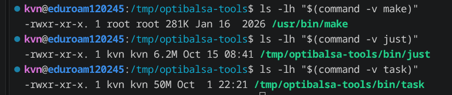
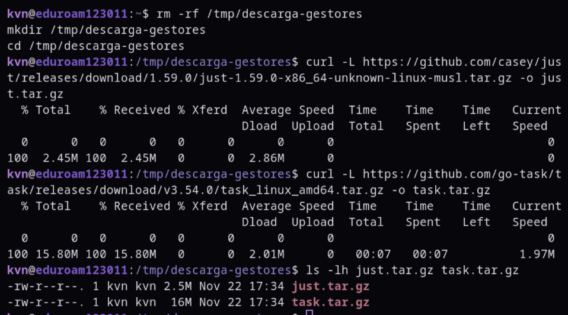
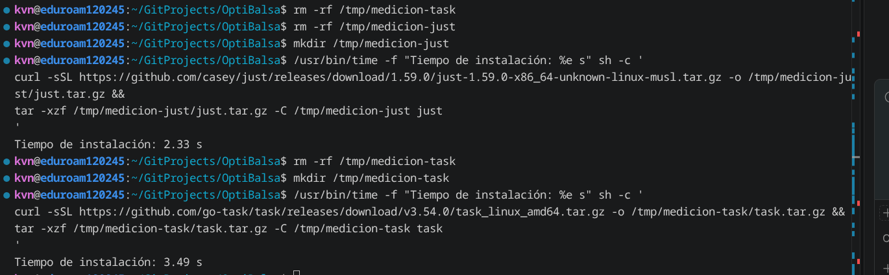
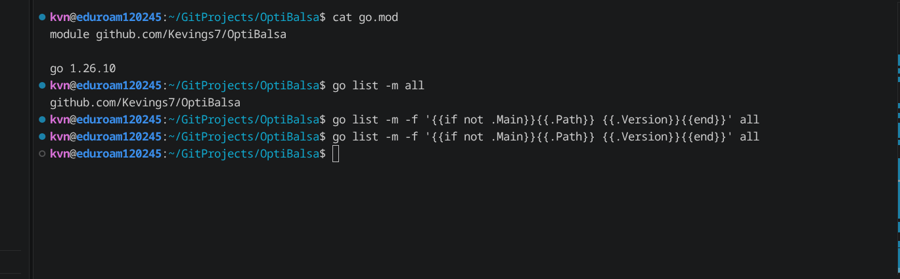
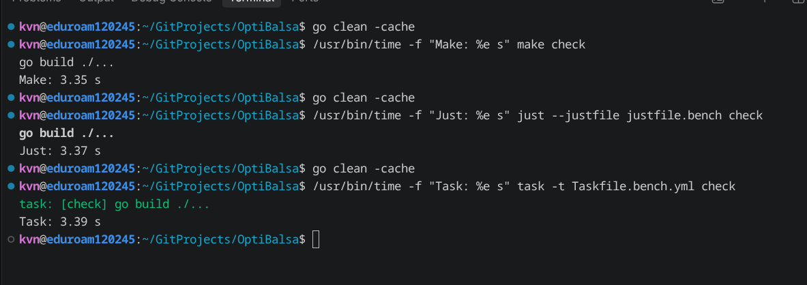
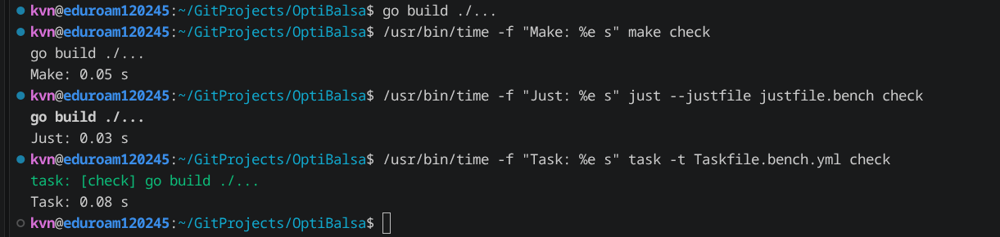
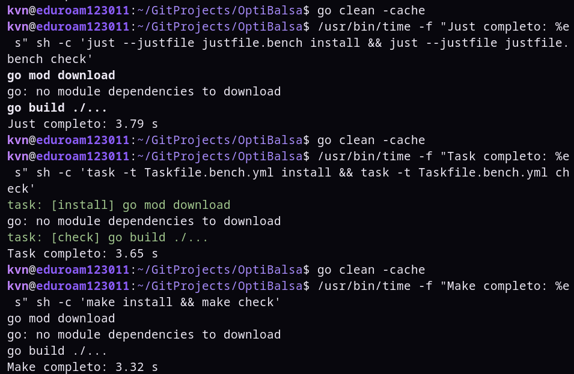

# Automatización del proyecto

## Gestor de tareas

### Alternativas consideradas

Se estudian las siguientes alternativas:

- GNU Make
- Just
- Task

La elección se realizará después de comparar las alternativas mediante mediciones realizadas sobre el mismo entorno.

## Criterios de comparación

Las herramientas de automatización se utilizarán posteriormente en entornos automatizados, especialmente contenedores. Por ello, debemos tener en cuenta ciertas características de cara a su elección.

Los criterios utilizados son los siguientes:

### Coste de instalación

Se tendrá en cuenta el tiempo necesario para disponer de cada gestor de tareas en el entorno utilizado para las pruebas.

Además del tiempo, se comprobará el tamaño que ocupa la herramienta instalada. Esto permite estimar el coste adicional que introduciría en futuros entornos de CI o contenedores.

### Dependencias adicionales

Se comprobará qué software adicional necesita cada alternativa para poder utilizarse. Se priorizarán las soluciones que introduzcan menos componentes adicionales en la infraestructura del proyecto.

### Gestión de dependencias del proyecto

OptiBalsa utiliza Go Modules como mecanismo de gestión de dependencias. Se comprobará cómo se integra la descarga de dependencias mediante `go mod download` con cada gestor de tareas.

Se distinguirá entre el coste de instalar el propio gestor de tareas y el coste de descargar las dependencias del proyecto.

### Tiempo de ejecución de tareas reales

Las alternativas se compararán ejecutando operaciones equivalentes del proyecto.

Se medirán las siguientes tareas:

- preparación de las dependencias;
- comprobación de la compilación de los fuentes.

Para que la comparación sea válida, los tres gestores ejecutarán exactamente las mismas órdenes de Go.

### Ejecución en un entorno limpio

Cuando sea relevante se realizarán mediciones sin reutilizar las dependencias descargadas previamente. De esta forma se aproxima el comportamiento de una ejecución de CI sin caché.

También se podrá comparar con una segunda ejecución utilizando los recursos ya descargados, que representa un entorno con caché.

### Uso posterior en automatización

Se tendrá en cuenta el coste que supone disponer de la herramienta en futuros workflows y contenedores. Este criterio se evaluará mediante datos medibles, como los pasos necesarios para instalarla, el tiempo de instalación y el tamaño añadido, evitando utilizar como criterio únicamente la familiaridad con la herramienta.

### Ligereza

Para comparar la ligereza de las herramientas se ha medido el tamaño en disco de sus ejecutables utilizando `ls -lh`. Las mediciones se han realizado sobre las versiones seleccionadas para la comparación.

| Herramienta | Versión | Tamaño del ejecutable |
| --- | --- | ---: |
| GNU Make | 4.4.1 | 281 KiB |
| Just | 1.59.0 | 6.2 MiB |
| Task | 3.54.0 | 50 MiB |

En el entorno medido, GNU Make presenta el ejecutable de menor tamaño. Just requiere aproximadamente 6.2 MiB, mientras que Task alcanza aproximadamente 50 MiB.

Esta diferencia es relevante de cara al uso posterior de la herramienta en contenedores y sistemas de integración continua, ya que una herramienta de mayor tamaño incrementa la cantidad de datos que deben incorporarse al entorno.

### Procedencia y mantenimiento de las herramientas

Antes de realizar las mediciones se ha comprobado que las herramientas utilizadas procedan de fuentes oficiales y que los proyectos sigan teniendo mantenimiento.

GNU Make ya se encontraba instalado en el sistema, por lo que no ha sido necesario descargarlo para realizar las pruebas. La versión utilizada es GNU Make 4.4.1, publicada oficialmente por el proyecto GNU el 26 de febrero de 2023. Aunque su fecha de publicación es anterior a las versiones utilizadas de Just y Task, se ha mantenido esta versión porque es la versión estable disponible en el entorno utilizado para las mediciones.

Just se ha descargado directamente desde la sección de releases de su repositorio oficial de GitHub, `casey/just`, utilizando el binario publicado para Linux. La versión utilizada, 1.59.0, fue publicada el 15 de octubre de 2026.

Task se ha descargado de la misma forma desde las releases de su repositorio oficial de GitHub, `go-task/task`. Se ha utilizado la versión 3.54.0, publicada el 1 de octubre de 2026.

De esta forma se evita utilizar versiones obtenidas desde fuentes externas o herramientas que puedan encontrarse abandonadas.

### Versiones utilizadas

Para las mediciones se han utilizado versiones estables de las tres herramientas.

En GNU Make se ha utilizado la versión 4.4.1, que es la versión que ya se encontraba instalada en la máquina utilizada para las pruebas.

Para Just se ha utilizado la versión 1.59.0 y para Task la versión 3.54.0. En ambos casos se han descargado las releases estables disponibles en sus repositorios oficiales.

No se han utilizado versiones nightly, beta o de desarrollo, ya que la intención es comparar versiones que se podrían utilizar de forma normal en un entorno de integración continua o en un contenedor.

### Descarga de las herramientas en el entorno de pruebas

Para comprobar el coste inicial de obtener las herramientas se han descargado directamente los binarios publicados en las releases oficiales de sus respectivos repositorios.

GNU Make 4.4.1 ya se encontraba instalado en `/usr/bin/make`, por lo que en esta máquina no ha sido necesario realizar ninguna descarga adicional. Esto no quiere decir que Make vaya a estar instalado siempre, ya que dependerá de la imagen o del sistema que se utilice posteriormente.

Just 1.59.0 se ha descargado desde la release oficial del repositorio `casey/just` mediante `curl`. El archivo comprimido descargado tiene un tamaño aproximado de 2.45 MiB.

Task 3.54.0 se ha descargado desde la release oficial de `go-task/task` utilizando el mismo procedimiento. En este caso el archivo descargado tiene un tamaño aproximado de 15.80 MiB.

| Herramienta | Versión | Tamaño de descarga observado |
| --- | --- | ---: |
| GNU Make | 4.4.1 | No ha sido necesaria en el entorno utilizado |
| Just | 1.59.0 | 2.45 MiB |
| Task | 3.54.0 | 15.80 MiB |

Estas medidas representan la cantidad de datos que se ha tenido que descargar en la máquina utilizada para las pruebas. Esto puede ser relevante posteriormente en contenedores o workflows, donde la herramienta podría tener que descargarse cada vez que se prepara un entorno nuevo.

Esta medición únicamente representa el tamaño de la descarga. Para tener también en cuenta el tiempo necesario para dejar la herramienta preparada se ha realizado una medición adicional.

### Tiempo de preparación de las herramientas

Para realizar esta medición se ha utilizado un pequeño script de shell que parte de un directorio temporal vacío, descarga la versión seleccionada de la herramienta desde su release oficial y la descomprime.

Se ha utilizado `/usr/bin/time` para medir cuánto tarda todo el proceso, desde que comienza la descarga hasta que el ejecutable queda disponible.

GNU Make 4.4.1 ya se encontraba disponible en `/usr/bin/make`, por lo que en esta máquina no ha sido necesario realizar ese proceso. Este dato solo representa el entorno utilizado para las pruebas y no implica que Make vaya a estar instalado en todos los entornos futuros.

| Herramienta | Versión | Tiempo de preparación |
| --- | --- | ---: |
| GNU Make | 4.4.1 | Ya disponible en el entorno |
| Just | 1.59.0 | 2.33 s |
| Task | 3.54.0 | 3.49 s |

El mismo procedimiento se ha utilizado para Just y Task, de forma que ambas herramientas se han medido en unas condiciones similares.

En la máquina utilizada, Just ha necesitado 2.33 segundos para quedar disponible y Task 3.49 segundos. Estos tiempos dependen también de la conexión de red utilizada en ese momento, en este caso la red de la universidad, por lo que se toman como una referencia del coste de preparación y no como un valor absoluto.

## Gestión de dependencias

Para gestionar las dependencias del proyecto se ha utilizado Go Modules, que forma parte de las herramientas estándar de Go. De esta forma no ha sido necesario añadir un gestor de dependencias externo al proyecto.

El módulo del proyecto se encuentra definido en `go.mod`:

`github.com/Kevings7/OptiBalsa`

Se ha utilizado `go list -m all` para comprobar los módulos utilizados actualmente por el proyecto. En el estado actual de OptiBalsa únicamente aparece el propio módulo, por lo que todavía no existen dependencias externas.

| Elemento | Estado actual |
| --- | --- |
| Gestor de dependencias | Go Modules |
| Fichero de módulos | `go.mod` |
| Dependencias externas | 0 |
| `go.sum` | No generado actualmente |

También se ha comprobado específicamente la existencia de dependencias externas mediante:

`go list -m -f '{{if not .Main}}{{.Path}} {{.Version}}{{end}}' all`

La orden no devuelve ningún resultado, lo que confirma que actualmente el proyecto no utiliza módulos externos.

Por este motivo tampoco existe todavía un fichero `go.sum`. No se ha creado de forma artificial, ya que actualmente no hay dependencias externas cuyas sumas de comprobación necesiten almacenarse.

Para instalar o descargar las dependencias del proyecto se ha utilizado:

`go mod download`

Esta operación se ha automatizado mediante la tarea:

`make install`

De esta forma, Go Modules sigue siendo el encargado de gestionar las dependencias y GNU Make únicamente se encarga de lanzar la tarea de una forma común junto al resto de operaciones del proyecto.

En el estado actual del proyecto no tiene demasiado sentido comparar tiempos de descarga de dependencias con y sin caché, ya que no existe ninguna dependencia externa que descargar. Cuando el proyecto incorpore dependencias, `go mod download` seguirá siendo la operación utilizada por la tarea de instalación.

### Tiempo de ejecución de la compilación

Para comprobar si el gestor de tareas introduce una diferencia apreciable al ejecutar una tarea real del proyecto, se ha medido el tiempo necesario para lanzar la comprobación de compilación.

Los tres gestores han ejecutado exactamente la misma orden:

`go build ./...`

#### Ejecución sin caché

Antes de cada medición se ha utilizado `go clean -cache`, de forma que ninguno de los gestores pueda aprovechar la caché de compilación generada por la ejecución anterior.

| Herramienta | Tiempo sin caché |
| --- | ---: |
| GNU Make | 3.35 s |
| Just | 3.37 s |
| Task | 3.39 s |

Los resultados sin caché son prácticamente iguales. Entre la ejecución más rápida y la más lenta solo hay una diferencia de 0.04 segundos, por lo que en este caso el tiempo está dominado por la propia compilación de Go y no por el gestor encargado de lanzar la tarea.

#### Ejecución con caché

También se ha realizado una segunda medición después de ejecutar previamente `go build ./...`, manteniendo la caché de compilación de Go.

| Herramienta | Tiempo con caché |
| --- | ---: |
| GNU Make | 0.05 s |
| Just | 0.03 s |
| Task | 0.08 s |

Con la caché disponible, Just ha obtenido el menor tiempo y Task el mayor. Aun así, las diferencias siguen siendo muy pequeñas: entre Just y Task hay únicamente 0.05 segundos.

Esta segunda medición permite observar mejor el pequeño coste que introduce cada gestor al lanzar una tarea cuando la operación realizada por Go apenas necesita trabajo. No obstante, la diferencia es demasiado pequeña como para utilizarla por sí sola como criterio principal de elección.

Teniendo en cuenta ambas pruebas, el tiempo de ejecución de `check` no permite diferenciar claramente entre GNU Make, Just y Task. Por ello se tendrá en cuenta junto con otros criterios como el tamaño, el coste de preparación y su uso posterior en workflows y contenedores.

### Ejecución del flujo completo

Además de medir únicamente la compilación, se ha comparado el tiempo necesario para ejecutar el flujo completo que se utilizaría posteriormente en un workflow: preparar las dependencias del proyecto y comprobar que los fuentes compilan correctamente.

En los tres gestores se han ejecutado las mismas órdenes:

`go mod download`

`go build ./...`

Antes de cada medición se ha utilizado `go clean -cache` para evitar que una herramienta se beneficie de la caché de compilación generada por la ejecución anterior.

| Herramienta | Tiempo del flujo completo |
| --- | ---: |
| GNU Make | 3.42 s |
| Just | 3.79 s |
| Task | 3.65 s |

En la máquina utilizada, GNU Make ha obtenido el menor tiempo, seguido de Task y Just. Si calculamos, diferencia entre la ejecución más rápida y la más lenta ha sido de 0.37 segundos.

Actualmente OptiBalsa no tiene dependencias externas, por lo que `go mod download` no tiene módulos adicionales que descargar y la mayor parte del tiempo de esta prueba corresponde a la compilación de Go.

Por este motivo, estos resultados se tendrán en cuenta junto con el tamaño de la herramienta, el coste de descarga, el tiempo de preparación y su uso posterior en workflows y contenedores.

## Resumen de resultados

Después de realizar las distintas pruebas, los resultados obtenidos han sido los siguientes:

| Criterio | GNU Make | Just | Task |
| --- | ---: | ---: | ---: |
| Tamaño del ejecutable | 281 KiB | 6.2 MiB | 50 MiB |
| Descarga observada | Ya disponible | 2.45 MiB | 15.80 MiB |
| Tiempo de preparación | Ya disponible | 2.33 s | 3.49 s |
| `check` sin caché | 3.35 s | 3.37 s | 3.39 s |
| `check` con caché | 0.05 s | 0.03 s | 0.08 s |
| Flujo `install + check` | 3.42 s | 3.79 s | 3.65 s |

En las tareas de compilación las diferencias entre los tres gestores han sido pequeñas. Sin caché solo existen 0.04 segundos entre el resultado más rápido y el más lento, por lo que esta prueba no permite diferenciar claramente entre las herramientas.

Las diferencias más grandes se han encontrado en el tamaño y en la preparación de las herramientas. GNU Make ya se encontraba disponible en el entorno utilizado y su ejecutable ocupa 281 KiB. Just y Task han necesitado una descarga y preparación adicional, siendo Task la alternativa de mayor tamaño.

## Elección

Después de realizar todas las mediciones se ha decidido mantener GNU Make como gestor de tareas de OptiBalsa.

El tiempo de ejecución de las tareas no muestra diferencias suficientemente grandes como para decidir únicamente a partir de este criterio. Just ha obtenido el mejor resultado en la ejecución con caché, mientras que GNU Make ha obtenido el mejor resultado en el flujo completo, en ambos casos las diferencias son pequeñas.

La principal diferencia se encuentra en el coste de incorporar cada herramienta al entorno. En la máquina utilizada GNU Make ya se encontraba disponible y además presenta el ejecutable de menor tamaño. Just y Task requieren incorporar herramientas adicionales, con un mayor tamaño y un proceso previo de descarga y preparación.

OptiBalsa utiliza Go Modules para gestionar sus dependencias, por lo que GNU Make no sustituye al gestor de dependencias. Su función será únicamente agrupar y ejecutar de forma sencilla las operaciones habituales del proyecto, como `go mod download` y `go build ./...`.

Esta elección se ha realizado teniendo también en cuenta su uso posterior en workflows y contenedores. Que GNU Make haya estado disponible en el entorno utilizado no implica que vaya a estar instalado en todos los entornos futuros, por lo que, cuando se definan estos entornos, habrá que asegurar explícitamente que la herramienta esté disponible.