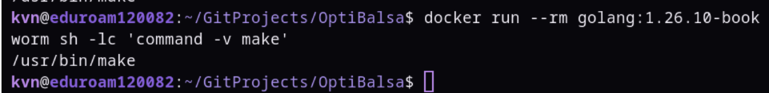
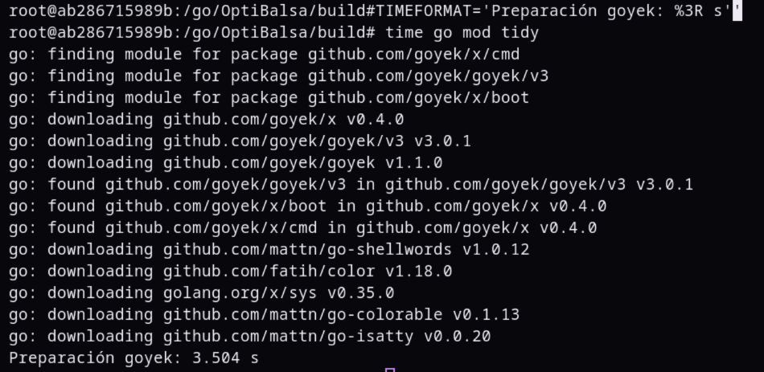
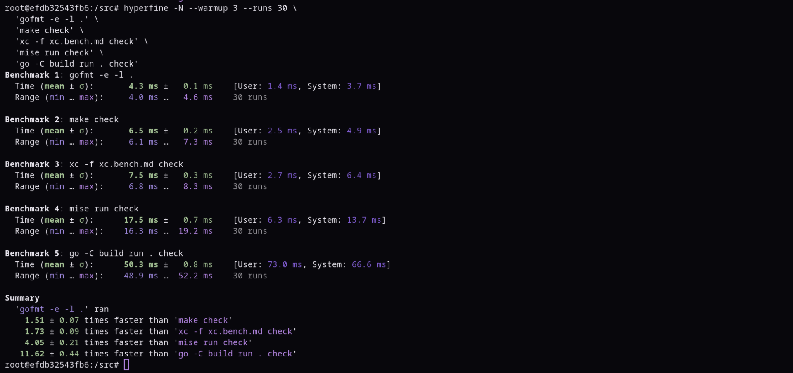

# Automatización del proyecto

## Gestor de dependencias

OptiBalsa utiliza Go Modules, integrado en Go, para gestionar las dependencias del proyecto.

Actualmente el proyecto no tiene dependencias externas, por lo que `go mod download` no descarga ningún módulo adicional. Esta orden se utiliza en la tarea `install` para que siga siendo válida cuando se incorporen dependencias.

## Gestor de tareas

Se han considerado cuatro herramientas. No se han incluido Just y Task porque en la revisión se pidió utilizar herramientas distintas de las habituales.

- **[GNU Make](https://www.gnu.org/software/make/):** las tareas se definen en un `Makefile`. Resulta interesante porque es una herramienta de propósito general que no depende del lenguaje del proyecto.
- **[xc](https://github.com/joerdav/xc):** las tareas se definen en un fichero Markdown. Resulta interesante porque las tareas quedan documentadas en el mismo fichero en el que se definen, sin añadir un formato de configuración específico.
- **[goyek](https://github.com/goyek/goyek):** las tareas se escriben en Go, en un módulo del propio proyecto. Resulta interesante porque en un proyecto escrito en Go permite definir las tareas con el mismo lenguaje y sus herramientas.
- **[mise](https://mise.jdx.dev/):** las tareas se definen en un `mise.toml`. Resulta interesante porque, además de ejecutar tareas, puede gestionar las versiones de las herramientas que necesita el proyecto.

### Criterios

- **Tiempo de preparación:** en un entorno vacío, como un contenedor o un workflow, hay que preparar el gestor antes de lanzar ninguna tarea. Se considera aceptable si queda disponible en menos de 10 s.
- **Tiempo que añade a `check`:** las tareas se lanzarán en cada cambio. Se compara con lo que tarda la misma orden sin ningún gestor, y se considera aceptable si añade menos de 50 ms por ejecución.

Entre las herramientas que cumplan los dos criterios, se elige la que menos tiempo sume.

### Pruebas

Las pruebas se han realizado en contenedores creados a partir de `golang:1.26.10-bookworm`, que contiene la misma versión de Go declarada por el proyecto. La preparación de cada herramienta se ha medido en un contenedor nuevo.

En las cuatro herramientas, `check` ejecuta `gofmt -e -l .`, que comprueba la sintaxis de los ficheros Go sin modificarlos ni compilar el proyecto.

Tiempo de preparación:

- GNU Make: ya disponible en la imagen, en `/usr/bin/make`.
- xc 0.9.0 (binario de su release oficial): **1,575 s**.
- goyek (descarga de su módulo): **3,504 s**.
- mise: **7,727 s**.

Tiempo de `check`, medido con Hyperfine con 3 ejecuciones de calentamiento y 30 mediciones por orden, sin pasar por la shell (opción `-N`) para que su tiempo de arranque no afecte a la medición:

- Sin gestor: **4,3 ms**.
- GNU Make: **6,5 ms** (añade 2,2 ms).
- xc: **7,5 ms** (añade 3,2 ms).
- mise: **17,5 ms** (añade 13,2 ms).
- goyek: **50,3 ms** (añade 46,0 ms, porque `go run` compila el código de las tareas antes de ejecutarlas).

## Elección

Se ha elegido GNU Make como gestor de tareas de OptiBalsa.

GNU Make ya está disponible en la imagen utilizada, por lo que no añade tiempo de preparación, frente a los 1,575 s de xc, los 3,504 s de goyek y los 7,727 s de mise. Al ejecutar `check` añade 2,2 ms respecto a la orden sin gestor, frente a los 3,2 ms de xc, los 13,2 ms de mise y los 46,0 ms de goyek.

Las cuatro herramientas cumplen los dos criterios, y GNU Make es la que obtiene el mejor resultado en ambos.

Go Modules seguirá siendo el encargado de gestionar las dependencias, y GNU Make se utilizará únicamente para lanzar las tareas `install` y `check`.