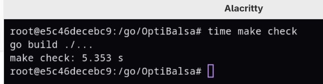
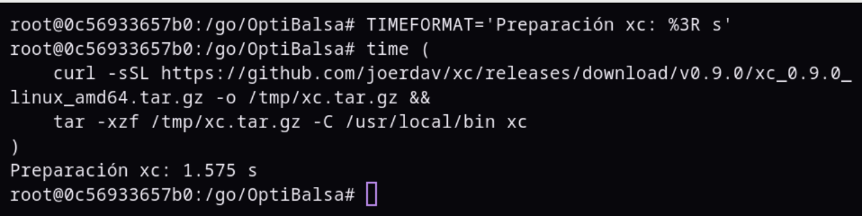
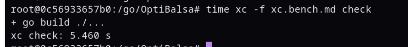
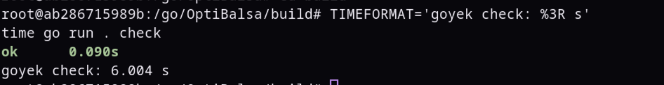
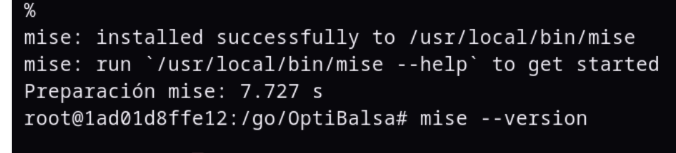
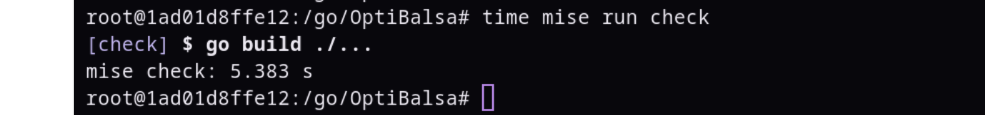

# Automatización del proyecto

## Gestor de dependencias

OptiBalsa utiliza Go Modules, integrado en Go, para gestionar las dependencias del proyecto.

Actualmente el proyecto no tiene dependencias externas, por lo que `go mod download` no descarga ningún módulo adicional. Esta orden se utiliza en la tarea `install` para que siga siendo válida cuando se incorporen dependencias.

## Gestor de tareas

Para elegir el gestor de tareas se han considerado [GNU Make](https://www.gnu.org/software/make/), [xc](https://github.com/joerdav/xc), [goyek](https://github.com/goyek/goyek) y [mise](https://mise.jdx.dev/).

Se han tenido en cuenta el tiempo necesario para preparar cada herramienta y el tiempo necesario para ejecutar la tarea `check`.

Las mediciones se han realizado en contenedores nuevos creados a partir de `golang:1.26.10-bookworm`, sobre la misma máquina y utilizando la misma revisión de OptiBalsa. Cada herramienta se ha probado en un contenedor nuevo para evitar que se beneficie de instalaciones anteriores.

En todos los casos `check` ejecuta:

`go build ./...`

Antes de medir su ejecución se ha utilizado `go clean -cache` para partir de las mismas condiciones.

### GNU Make

[GNU Make](https://www.gnu.org/software/make/) es una herramienta de automatización de propósito general basada en un `Makefile`. Resulta interesante porque permite agrupar las operaciones habituales del proyecto sin depender del lenguaje utilizado.

GNU Make ya se encuentra disponible en la imagen `golang:1.26.10-bookworm`, en `/usr/bin/make`, por lo que no necesita ningún paso adicional de preparación. La ejecución de `check` ha necesitado **5,353 s**.

### xc

[xc](https://github.com/joerdav/xc) permite definir las tareas directamente mediante Markdown. Resulta interesante porque las tareas pueden mantenerse junto a su documentación, reduciendo la necesidad de añadir un formato de configuración específico únicamente para automatizarlas.

Se ha descargado desde su release oficial. Ha necesitado **1.575 s** para quedar disponible y **5.460 s** para ejecutar `check`.

### goyek

[goyek](https://github.com/goyek/goyek) permite definir la automatización mediante código Go. Resulta interesante en un proyecto escrito en Go porque permite implementar las tareas utilizando el mismo lenguaje y sus herramientas, en lugar de introducir otro formato de configuración.

Para probarlo se ha creado un pequeño módulo de automatización con una tarea `check`. La preparación de sus dependencias ha necesitado **3.504 s** y la ejecución de `check` **6.004 s**.

### mise

[mise](https://mise.jdx.dev/) permite definir y ejecutar tareas de proyecto y también gestionar herramientas del entorno. Puede resultar interesante cuando, además de automatizar órdenes, el proyecto necesita controlar las versiones de las herramientas utilizadas.

Su instalación ha necesitado **7.727 s** y la ejecución de `check` **5.383 s**.

