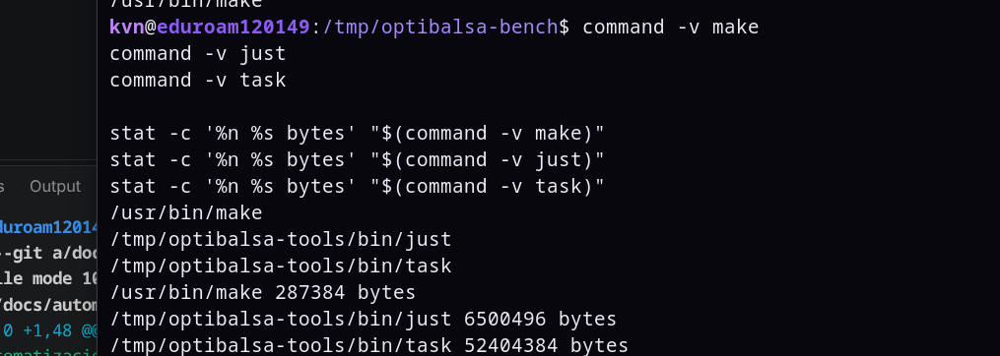
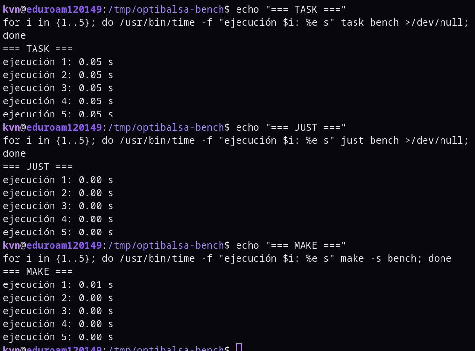

# Automatización del proyecto

## Gestión de dependencias

OptiBalsa utiliza Go Modules mediante `go.mod`.

Go incorpora de forma nativa la gestión de módulos y dependencias, por lo que
no es necesario añadir un gestor de dependencias externo al proyecto.

## Gestor de tareas

### Alternativas consideradas

Se estudian las siguientes alternativas:

- GNU Make
- Just
- Task

La elección se realizará después de comparar las alternativas mediante
mediciones realizadas sobre el mismo entorno.

## Criterios

### Requisitos de instalación

Se estudia qué necesita cada herramienta para estar disponible en el entorno.

Este criterio es relevante porque la herramienta se utilizará posteriormente
en entornos automatizados como CI y contenedores, donde añadir herramientas
adicionales supone aumentar el tiempo y los componentes necesarios para
preparar el entorno.

Además de comprobar si la herramienta estaba disponible inicialmente, se mide
el tamaño del binario utilizado.

### Tiempo de ejecución

Se mide el tiempo necesario para lanzar mediante cada herramienta una misma
operación sencilla del proyecto.

Para que la comparación sea equivalente, las tres herramientas ejecutan:

```bash
go version > /dev/null
```

Se realizan cinco ejecuciones de cada alternativa utilizando `/usr/bin/time`.

## Resultados

### Disponibilidad y tamaño

En el entorno utilizado para realizar las pruebas, GNU Make ya se encontraba
instalado.

Just y Task no estaban disponibles inicialmente, por lo que fue necesario
instalar sus binarios para poder realizar la comparación.

Los tamaños obtenidos fueron:

| Herramienta | Disponibilidad inicial | Tamaño del binario |
|---|---|---:|
| GNU Make | Ya disponible | 287384 bytes (~0,29 MB) |
| Just | Instalación adicional | 65000496 bytes (~65,0 MB) |
| Task | Instalación adicional | 52404384 bytes (~52,4 MB) |

En el entorno utilizado para las mediciones, Make presenta un coste en tamaño
considerablemente menor que las otras dos alternativas y no necesitó una
instalación adicional.

Estos valores corresponden al entorno concreto en el que se realizaron las
pruebas y a los binarios utilizados.



### Tiempo de ejecución

Las cinco ejecuciones obtenidas fueron:

| Herramienta | Ejecución 1 | Ejecución 2 | Ejecución 3 | Ejecución 4 | Ejecución 5 |
|---|---:|---:|---:|---:|---:|
| GNU Make | 0.01 s | 0.00 s | 0.00 s | 0.00 s | 0.00 s |
| Just | 0.00 s | 0.00 s | 0.00 s | 0.00 s | 0.00 s |
| Task | 0.05 s | 0.05 s | 0.05 s | 0.05 s | 0.05 s |

Make y Just quedan por debajo o muy cerca de la resolución utilizada en la
medición, por lo que estos resultados no permiten establecer una diferencia
significativa de rendimiento entre ambos.

Task sí muestra en esta prueba un coste mayor y estable, alrededor de 0.05
segundos por ejecución.



## Elección

La elección de la herramienta se realizará en un commit posterior a estas
mediciones, utilizando los resultados obtenidos y los criterios establecidos
previamente.