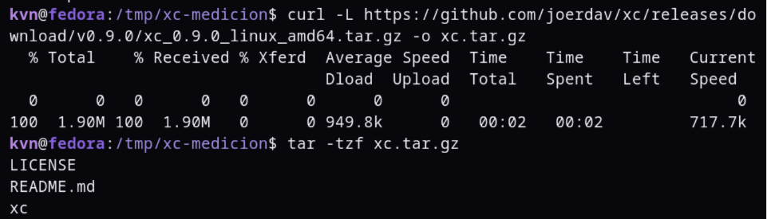
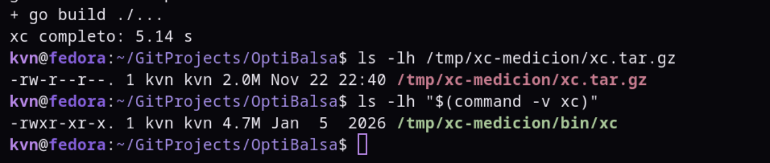
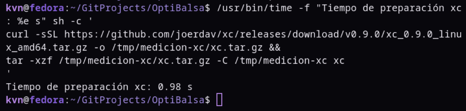
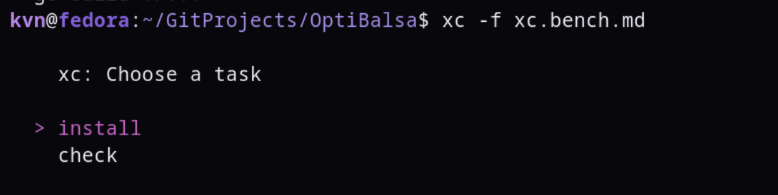
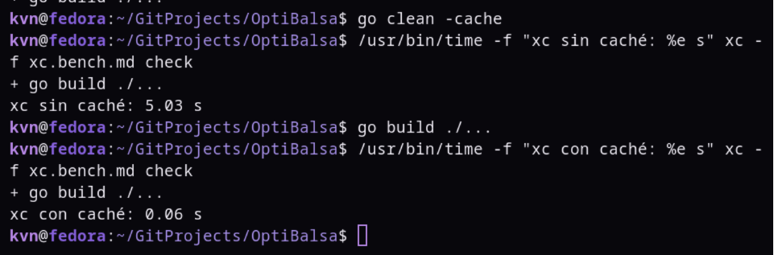
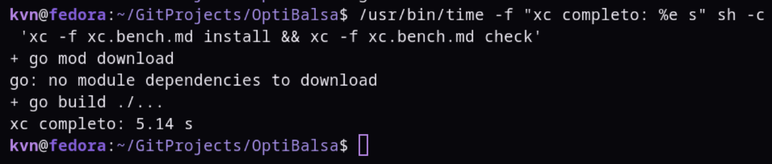

# Automatización del proyecto

## Gestor de tareas

### Alternativas consideradas

Se estudian las siguientes alternativas:

- GNU Make
- Just
- Task
- [xc](https://github.com/joerdav/xc)

La elección se realizará después de comparar las alternativas mediante mediciones realizadas sobre el mismo entorno.

## Criterios de comparación

Las herramientas de automatización se utilizarán posteriormente en entornos automatizados, especialmente contenedores. Por ello, debemos tener en cuenta ciertas características de cara a su elección.

Los criterios utilizados son los siguientes:

### Coste de incorporación al entorno

Se medirá el coste necesario para disponer de cada gestor de tareas en el entorno utilizado para las pruebas.

Para compararlo se utilizarán tres medidas:

- tamaño de la descarga necesaria;
- tamaño del ejecutable instalado;
- tiempo necesario para descargarlo y dejarlo disponible.

El hecho de que una herramienta necesite instalar un binario no será motivo de descarte por sí solo. La comparación se realizará a partir del coste medido que introduce.

### Gestión de dependencias del proyecto

OptiBalsa utiliza Go Modules como mecanismo de gestión de dependencias. Se comprobará cómo se integra la descarga de dependencias mediante `go mod download` con cada gestor de tareas.

Se distinguirá entre el coste de instalar el propio gestor de tareas y el coste de descargar las dependencias del proyecto.

### Tiempo de ejecución de tareas reales

Las alternativas se compararán ejecutando operaciones equivalentes del proyecto.

Se medirán las siguientes tareas:

- preparación de las dependencias;
- comprobación de la compilación de los fuentes.

Para que la comparación sea válida, los cuatro gestores ejecutarán exactamente las mismas órdenes de Go.

### Ejecución en un entorno limpio

Cuando sea relevante se realizarán mediciones sin reutilizar las dependencias descargadas previamente. De esta forma se aproxima el comportamiento de una ejecución de CI sin caché.

También se podrá comparar con una segunda ejecución utilizando los recursos ya descargados, que representa un entorno con caché.

### Uso posterior en automatización

Se tendrá en cuenta el coste que supone disponer de la herramienta en futuros workflows y contenedores. Este criterio se evaluará mediante datos medibles, como los pasos necesarios para instalarla, el tiempo de instalación y el tamaño añadido, evitando utilizar como criterio únicamente la familiaridad con la herramienta.

### Ligereza

Para comparar la ligereza de las herramientas se ha medido el tamaño en disco de sus ejecutables utilizando `ls -lh`. Las mediciones se han realizado sobre las versiones seleccionadas para la comparación.

| Herramienta | Versión | Tamaño del ejecutable |
| --- | --- | ---: |
| GNU Make | 4.4.1 | 281 KiB |
| Just | 1.59.0 | 6.2 MiB |
| Task | 3.54.0 | 50 MiB |
| xc | 0.9.0 | 4.7 MiB |


En el entorno medido, GNU Make presenta el ejecutable de menor tamaño. Just requiere aproximadamente 6.2 MiB, mientras que Task alcanza aproximadamente 50 MiB.

Esta diferencia es relevante de cara al uso posterior de la herramienta en contenedores y sistemas de integración continua, ya que una herramienta de mayor tamaño incrementa la cantidad de datos que deben incorporarse al entorno.

### Procedencia y mantenimiento de las herramientas

Antes de realizar las mediciones se ha comprobado que las versiones utilizadas procedan de las fuentes oficiales de cada herramienta.

GNU Make ya se encontraba instalado en el sistema, por lo que no ha sido necesario descargarlo para realizar las pruebas. Se ha utilizado la versión 4.4.1, publicada oficialmente por el proyecto GNU el 26 de febrero de 2023.

Just se ha descargado desde la sección de releases de su repositorio oficial `casey/just`, utilizando el binario publicado para Linux. La versión utilizada ha sido la 1.59.0, publicada el 15 de octubre de 2026.

Task se ha descargado desde las releases de su repositorio oficial `go-task/task`. Se ha utilizado la versión 3.54.0, publicada el 1 de octubre de 2026.

`xc` se ha descargado desde las releases de su repositorio oficial `joerdav/xc`. Se ha utilizado la versión 0.9.0, publicada el 5 de enero de 2026.

Las versiones utilizadas en las mediciones proceden, por tanto, de las fuentes oficiales de cada herramienta.

### Versiones utilizadas

Para las mediciones se han utilizado versiones estables de las cuatro herramientas.

En GNU Make se ha utilizado la versión 4.4.1, que es la versión que ya se encontraba instalada en la máquina utilizada para las pruebas.

Para Just se ha utilizado la versión 1.59.0 y para Task la versión 3.54.0. En ambos casos se han descargado las releases estables disponibles en sus repositorios oficiales.

Para `xc` se ha utilizado la versión 0.9.0 descargada desde la release oficial de su repositorio.

No se han utilizado versiones nightly, beta o de desarrollo, ya que la intención es comparar versiones que se podrían utilizar de forma normal en un entorno de integración continua o en un contenedor.

### Descarga de las herramientas en el entorno de pruebas

Para comprobar el coste inicial de obtener las herramientas se han descargado directamente los binarios publicados en las releases oficiales de sus respectivos repositorios.

GNU Make 4.4.1 ya se encontraba instalado en `/usr/bin/make`, por lo que en esta máquina no ha sido necesario realizar ninguna descarga adicional. Esto no quiere decir que Make vaya a estar instalado siempre, ya que dependerá de la imagen o del sistema que se utilice posteriormente.

Just 1.59.0 se ha descargado desde la release oficial del repositorio `casey/just` mediante `curl`. El archivo comprimido descargado tiene un tamaño aproximado de 2.45 MiB.

Task 3.54.0 se ha descargado desde la release oficial de `go-task/task` utilizando el mismo procedimiento. En este caso el archivo descargado tiene un tamaño aproximado de 15.80 MiB.

 

| Herramienta | Versión | Tamaño de descarga observado |
| --- | --- | ---: |
| GNU Make | 4.4.1 | No ha sido necesaria en el entorno utilizado |
| Just | 1.59.0 | 2.45 MiB |
| Task | 3.54.0 | 15.80 MiB |
| xc | 0.9.0 | 2.0 MiB |

Estas medidas representan la cantidad de datos que se ha tenido que descargar en la máquina utilizada para las pruebas. Esto puede ser relevante posteriormente en contenedores o workflows, donde la herramienta podría tener que descargarse cada vez que se prepara un entorno nuevo.

Esta medición únicamente representa el tamaño de la descarga. Para tener también en cuenta el tiempo necesario para dejar la herramienta preparada se ha realizado una medición adicional.

### Tiempo de preparación de las herramientas

Para realizar esta medición se ha utilizado un pequeño script de shell que parte de un directorio temporal vacío, descarga la versión seleccionada de la herramienta desde su release oficial y la descomprime.

Se ha utilizado `/usr/bin/time` para medir cuánto tarda todo el proceso, desde que comienza la descarga hasta que el ejecutable queda disponible.

GNU Make 4.4.1 ya se encontraba disponible en `/usr/bin/make`, por lo que en esta máquina no ha sido necesario realizar ese proceso. Este dato solo representa el entorno utilizado para las pruebas y no implica que Make vaya a estar instalado en todos los entornos futuros.

| Herramienta | Versión | Tiempo de preparación |
| --- | --- | ---: |
| GNU Make | 4.4.1 | Ya disponible en el entorno |
| Just | 1.59.0 | 2.33 s |
| Task | 3.54.0 | 3.49 s |
| xc | 0.9.0 | 0.98 s |


El mismo procedimiento se ha utilizado para Just y Task, de forma que ambas herramientas se han medido en unas condiciones similares.

En la máquina utilizada, Just ha necesitado 2.33 segundos para quedar disponible y Task 3.49 segundos. Estos tiempos dependen también de la conexión de red utilizada en ese momento, en este caso la red de la universidad, por lo que se toman como una referencia del coste de preparación y no como un valor absoluto.

## Gestión de dependencias

Para gestionar las dependencias del proyecto se ha utilizado Go Modules, que forma parte de las herramientas estándar de Go. De esta forma no ha sido necesario añadir un gestor de dependencias externo al proyecto.

El módulo del proyecto se encuentra definido en `go.mod`:

`github.com/Kevings7/OptiBalsa`

Se ha utilizado `go list -m all` para comprobar los módulos utilizados actualmente por el proyecto. En el estado actual de OptiBalsa únicamente aparece el propio módulo, por lo que todavía no existen dependencias externas.

| Elemento | Estado actual |
| --- | --- |
| Gestor de dependencias | Go Modules |
| Fichero de módulos | `go.mod` |
| Dependencias externas | 0 |
| `go.sum` | No generado actualmente |

También se ha comprobado específicamente la existencia de dependencias externas mediante:

`go list -m -f '{{if not .Main}}{{.Path}} {{.Version}}{{end}}' all`

La orden no devuelve ningún resultado, lo que confirma que actualmente el proyecto no utiliza módulos externos.

Por este motivo tampoco existe todavía un fichero `go.sum`. No se ha creado de forma artificial, ya que actualmente no hay dependencias externas cuyas sumas de comprobación necesiten almacenarse.

Para instalar o descargar las dependencias del proyecto se ha utilizado:

`go mod download`

Esta operación se ha automatizado mediante la tarea:

`make install`

De esta forma, Go Modules sigue siendo el encargado de gestionar las dependencias y GNU Make únicamente se encarga de lanzar la tarea de una forma común junto al resto de operaciones del proyecto.


En el estado actual del proyecto no tiene demasiado sentido comparar tiempos de descarga de dependencias con y sin caché, ya que no existe ninguna dependencia externa que descargar. Cuando el proyecto incorpore dependencias, `go mod download` seguirá siendo la operación utilizada por la tarea de instalación.

### Tiempo de ejecución de la compilación

Para comprobar si el gestor de tareas introduce una diferencia apreciable al ejecutar una tarea real del proyecto, se ha medido el tiempo necesario para lanzar la comprobación de compilación.

Los tres gestores han ejecutado exactamente la misma orden:

`go build ./...`

#### Ejecución sin caché

Antes de cada medición se ha utilizado `go clean -cache`, de forma que ninguno de los gestores pueda aprovechar la caché de compilación generada por la ejecución anterior.

| Herramienta | Tiempo sin caché |
| --- | ---: |
| GNU Make | 3.35 s |
| Just | 3.37 s |
| Task | 3.39 s |


Los resultados sin caché son prácticamente iguales. Entre la ejecución más rápida y la más lenta solo hay una diferencia de 0.04 segundos, por lo que en este caso el tiempo está dominado por la propia compilación de Go y no por el gestor encargado de lanzar la tarea.

#### Ejecución con caché

También se ha realizado una segunda medición después de ejecutar previamente `go build ./...`, manteniendo la caché de compilación de Go.

| Herramienta | Tiempo con caché |
| --- | ---: |
| GNU Make | 0.05 s |
| Just | 0.03 s |
| Task | 0.08 s |


Con la caché disponible, Just ha obtenido el menor tiempo y Task el mayor. Aun así, las diferencias siguen siendo muy pequeñas: entre Just y Task hay únicamente 0.05 segundos.

Esta segunda medición permite observar mejor el pequeño coste que introduce cada gestor al lanzar una tarea cuando la operación realizada por Go apenas necesita trabajo. No obstante, la diferencia es demasiado pequeña como para utilizarla por sí sola como criterio principal de elección.

Teniendo en cuenta ambas pruebas, el tiempo de ejecución de `check` no permite diferenciar claramente entre GNU Make, Just y Task. Por ello se tendrá en cuenta junto con otros criterios como el tamaño, el coste de preparación y su uso posterior en workflows y contenedores.

### Ejecución del flujo completo

Además de medir únicamente la compilación, se ha comparado el tiempo necesario para ejecutar el flujo completo que se utilizaría posteriormente en un workflow: preparar las dependencias del proyecto y comprobar que los fuentes compilan correctamente.

En los tres gestores se han ejecutado las mismas órdenes:

`go mod download`

`go build ./...`

Antes de cada medición se ha utilizado `go clean -cache` para evitar que una herramienta se beneficie de la caché de compilación generada por la ejecución anterior.

| Herramienta | Tiempo del flujo completo |
| --- | ---: |
| GNU Make | 3.42 s |
| Just | 3.79 s |
| Task | 3.65 s |


En la máquina utilizada, GNU Make ha obtenido el menor tiempo, seguido de Task y Just. Si calculamos, diferencia entre la ejecución más rápida y la más lenta ha sido de 0.37 segundos.

Actualmente OptiBalsa no tiene dependencias externas, por lo que `go mod download` no tiene módulos adicionales que descargar y la mayor parte del tiempo de esta prueba corresponde a la compilación de Go.

Por este motivo, estos resultados se tendrán en cuenta junto con el tamaño de la herramienta, el coste de descarga, el tiempo de preparación y su uso posterior en workflows y contenedores.

### xc

Como alternativa adicional a GNU Make, Just y Task se ha considerado [`xc`](https://github.com/joerdav/xc). `xc` es un gestor de tareas que permite definir las operaciones directamente en un fichero Markdown. La documentación oficial de `xc` está disponible en [xcfile.dev](https://xcfile.dev/).

A diferencia de Make, donde las tareas se definen en un `Makefile`, `xc` utiliza encabezados y bloques de código Markdown. Esto permite que las órdenes utilizadas por el proyecto queden documentadas en el mismo fichero en el que se definen.

El proyecto oficial define `xc` como un gestor de tareas basado en documentación. `xc` permite utilizar tanto el `README.md` como otro fichero Markdown mediante la opción `-f`.

Para realizar las pruebas se ha creado temporalmente un fichero `xc.bench.md` con las mismas operaciones utilizadas con el resto de gestores. En ese fichero, el encabezado `## Tasks` abre la lista de tareas y cada encabezado `###` define una tarea:

````markdown
# Benchmark xc

## Tasks

### install

```sh
go mod download
```

### check

```sh
go build ./...
```
````

De esta forma, la tarea de comprobación se ha ejecutado mediante:

`xc -f xc.bench.md check`

y el flujo completo mediante las tareas `install` y `check`.

La herramienta se ha descargado desde la release oficial para Linux de `joerdav/xc`. Se ha utilizado la versión 0.9.0.



El archivo comprimido descargado ocupa aproximadamente 2.0 MiB y el ejecutable resultante ocupa aproximadamente 4.7 MiB.



Para comprobar el coste de preparar la herramienta desde un entorno temporal vacío se ha medido el tiempo necesario para descargar la release y extraer el ejecutable.

El tiempo obtenido ha sido:

| Herramienta | Tiempo de preparación |
| --- | ---: |
| xc | 0.98 s |



También se ha comprobado que `xc` reconoce correctamente las tareas definidas en el fichero Markdown y permite ejecutarlas de forma independiente.



#### Ejecución de `check`

Para mantener las mismas condiciones utilizadas con GNU Make, Just y Task, se ha ejecutado exactamente la misma orden de Go:

`go build ./...`

Primero se ha limpiado la caché de compilación mediante `go clean -cache`.

| Estado | Tiempo |
| --- | ---: |
| Sin caché | 5.03 s |
| Con caché | 0.06 s |



Con la caché de Go disponible, el tiempo obtenido por `xc` es similar al del resto de gestores. Sin caché, en cambio, la medición obtenida ha sido superior a las realizadas con GNU Make, Just y Task.

#### Ejecución del flujo completo

También se ha medido el mismo flujo utilizado en las demás alternativas:

`go mod download`

`go build ./...`

Antes de la medición se ha limpiado la caché de compilación de Go.

| Herramienta | Tiempo del flujo completo |
| --- | ---: |
| xc | 5.14 s |



En las mediciones realizadas, `xc` presenta un coste de preparación reducido y un tamaño inferior al de Just y Task. Sin embargo, el tiempo obtenido en la ejecución sin caché y en el flujo completo ha sido superior al de las otras alternativas consideradas.

Por tanto, `xc` aporta un enfoque diferente al permitir definir y documentar las tareas mediante Markdown, pero su elección se valorará utilizando los mismos criterios objetivos que el resto de herramientas y no únicamente por esta característica.

## Resumen de resultados

Después de realizar las distintas pruebas, los resultados obtenidos han sido los siguientes:

| Criterio | GNU Make | Just | Task | xc |
| --- | ---: | ---: | ---: | ---: |
| Tamaño del ejecutable | 281 KiB | 6.2 MiB | 50 MiB | 4.7 MiB |
| Tamaño de descarga | Ya disponible | 2.45 MiB | 15.80 MiB | 2.0 MiB |
| Tiempo de preparación | Ya disponible | 2.33 s | 3.49 s | 0.98 s |
| `check` sin caché | 3.35 s | 3.37 s | 3.39 s | 5.03 s |
| `check` con caché | 0.05 s | 0.03 s | 0.08 s | 0.06 s |
| Flujo `install + check` | 3.42 s | 3.79 s | 3.65 s | 5.14 s |

En las ejecuciones con caché las diferencias entre las cuatro herramientas son pequeñas. Sin caché, GNU Make, Just y Task han obtenido resultados similares, mientras que `xc` ha necesitado más tiempo.

En cuanto al coste de incorporación al entorno, `xc` ha obtenido el menor tiempo de preparación entre las herramientas que se han tenido que descargar y su ejecutable es más pequeño que los de Just y Task.

Por tanto, ninguna medida aislada determina la elección. Los resultados de ejecución y el coste de incorporación se tendrán en cuenta conjuntamente.

## Elección

Después de realizar todas las mediciones se ha decidido mantener GNU Make como gestor de tareas de OptiBalsa.

Los tiempos de ejecución con caché son muy similares entre las cuatro herramientas. Just ha obtenido 0.03 s, GNU Make 0.05 s, `xc` 0.06 s y Task 0.08 s, por lo que estas diferencias son demasiado pequeñas para determinar por sí solas la elección.

En las ejecuciones sin caché, GNU Make, Just y Task han obtenido resultados cercanos, entre 3.35 y 3.39 segundos, mientras que `xc` ha necesitado 5.03 segundos. En el flujo completo `install + check` ocurre algo parecido: GNU Make ha obtenido 3.42 s, Task 3.65 s, Just 3.79 s y `xc` 5.14 s.

En cuanto al coste de incorporación al entorno, `xc` ha obtenido un resultado favorable: su descarga ocupa aproximadamente 2.0 MiB, su ejecutable 4.7 MiB y ha necesitado 0.98 s para quedar disponible. Just y Task presentan un coste mayor en alguna o varias de estas medidas. GNU Make tiene el ejecutable de menor tamaño, aunque en el entorno utilizado ya se encontraba instalado y por ello no se ha podido medir su preparación en las mismas condiciones.

Teniendo en cuenta conjuntamente las medidas realizadas, se mantiene GNU Make. Presenta el menor tamaño de ejecutable y ha obtenido los mejores resultados en la ejecución sin caché y en el flujo completo. `xc` resulta especialmente favorable en el tiempo de preparación y presenta un tamaño reducido, pero en las tareas ejecutadas desde un entorno sin caché ha obtenido tiempos superiores.

OptiBalsa utiliza Go Modules para gestionar sus dependencias, por lo que GNU Make no sustituye al gestor de dependencias. Su función es agrupar y ejecutar de forma común operaciones como `go mod download` y `go build ./...`.

La disponibilidad previa de GNU Make en la máquina utilizada no se considera por sí sola una razón para elegirlo, ya que no se puede asumir que vaya a estar instalado en todos los entornos futuros. La elección se basa en el conjunto de las mediciones realizadas.
